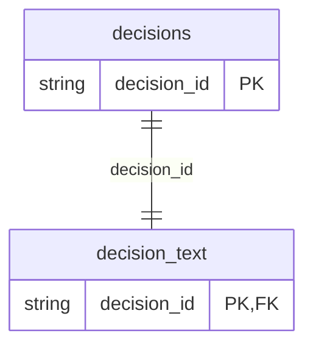

<!-- Generated by src/data_docs.py; edit docs/tables.toml instead. -->
# Data dictionary

Generated by `src/data_docs.py` on 2026-11-16 from Hugging Face `abigailhaddad/dol-arb-decisions` at commit `5604d583`. Types, row counts, non-null shares and examples are read from the parquet files; descriptions are in `docs/tables.toml` in the GitHub repo. Columns marked **(meaning not confirmed)** are ones whose meaning the source does not define.

| table | file | Hugging Face config | rows | one row is |
|---|---|---|---|---|
| `decisions` | `decisions.parquet` | `decisions` | 3,418 | One row per ARB decision: each decision line on DOL's by-name listing (a decision listed under two names with the same links and date is one row), plus decisions only the by-month listing has. |
| `decision_text` | `decision_text.parquet` | `decision_text` | 3,418 | One row per row of `decisions`, with the text of its document where it was fetched. |

## How the tables join

- `decisions.decision_id` to `decision_text.decision_id`: Exact join, one to one.

## `decisions` (`decisions.parquet`, config `decisions`)

One row per ARB decision: each decision line on DOL's by-name listing (a decision listed under two names with the same links and date is one row), plus decisions only the by-month listing has.

Non-null and non-blank are shares of the table's rows; non-blank also leaves out empty strings.

| column | type | description | non-null | non-blank | example |
|---|---|---|---|---|---|
| `decision_id` | string | The decision's link from `/PUBLIC/` on, without the `.../ARB_DECISIONS/` folder prefix, upper-cased (e.g. `DBA/2026-0047-DBAP.PDF`). `UNLINKED-nnn` for a row with no link. When two rows share a link, `@` and the date are added. Primary key. | 100.0% | 100.0% | `SCA/14_021.SCAP.PDF` |
| `decision_date` | date32[day] | The first date in parentheses on the decision line, e.g. `(ARB June 24, 2015)`. Null when the listing's date is broken or absent (not guessed). | 99.6% | 99.6% | `2015-06-24` |
| `issued_by` | string | The issuer before that date: `ARB`, `Sec'y`, `PWBA`, `OAA` or `Deputy Sec'y`. Null when the date has no issuer. | 99.1% | 99.1% | `ARB` |
| `decision_title` | string | The decision line's title as listed, before the date (e.g. `Final Decision and Order`). Not standardized: `&` and `and` forms both appear. | 100.0% | 100.0% | `Final Decision and Order` |
| `case_name` | string | The parties from the caption, after the leading ARB and ALJ numbers (e.g. `Powers v. Pinnacle Airlines, Inc.`). For by-date-only rows, the text before the ARB or ALJ number on the month page. | 100.0% | 100.0% | `Administrator, Wage and Hour Div., USDOL v. 5 Star Forestry,...` |
| `indexed_names` | string | The bold name(s) the by-name listing files the caption under, `; `-separated when one decision is listed under two names. Null for by-date-only rows. | 99.0% | 99.0% | `5 Star Forestry, LLC` |
| `arb_numbers` | string | ARB case numbers from the caption, before any ALJ number, `; `-separated (e.g. `96-134; 98-115`). | 97.4% | 97.4% | `14-021` |
| `alj_numbers` | string | ALJ case numbers from the caption (year-code-number, e.g. `2004-AIR-11`), `; `-separated. | 92.8% | 92.8% | `2013-SCA-4` |
| `program` | string | Case-type code: the folder in the decision's link (`STA`, `ERA`, `SOX`, `AIR`, `DBA`, ...). For a row with no such folder, the code from its ALJ number when it has exactly one. These are OALJ's case-type codes; the table doesn't translate them. | 100.0% | 100.0% | `SCA` |
| `program_source` | string | Where `program` came from: `link folder` or `ALJ number`. | 100.0% | 100.0% | `link folder` |
| `file_number_in_caption` | bool | True if the ARB number in the file name (e.g. `2024-0049-ERAP.pdf` or `09_076.SOXP.PDF`) is among the ARB numbers in the caption or decision line. Null when the file name has no ARB number. | 96.4% | 96.4% | `True` |
| `url` | string | The decision line's first document link, absolute. Most pre-2020 links are on www.oalj.dol.gov, newer ones on www.dol.gov. Null when the line has no link. | 99.4% | 99.4% | `https://www.oalj.dol.gov/PUBLIC/ARB/DECISIONS/ARB_DECISIONS/...` |
| `other_urls` | string | The line's other document links (e.g. an HTML or slip opinion copy), space-separated. | 4.6% | 4.6% | `https://www.oalj.dol.gov/PUBLIC/ARB/DECISIONS/ARB_DECISIONS/...` |
| `listing_line` | string | The decision line's text as listed (title, issuer and date, `PDF`). | 100.0% | 100.0% | `Final Decision and Order (ARB June 24, 2015) PDF` |
| `caption` | string | The caption paragraph above the decision line on the by-name listing (ARB and ALJ numbers, parties). Null for by-date-only rows and lines with no caption. | 99.0% | 99.0% | `ARB No. 14-021, ALJ No. 2013-SCA-4 Administrator, Wage and H...` |
| `listing_page` | string | The page the row came from: `ARBLIST_A-H`, `ARBLIST_I-P` or `ARBLIST_Q-Z` on the by-name listing, or the month page (`MM_YYYY`) for by-date-only rows. | 100.0% | 100.0% | `ARBLIST_A-H` |
| `times_listed` | int64 | How many by-name decision lines were collapsed into this row (same links and date). | 100.0% | 100.0% | `1` |
| `listed_on` | string | `both` (a by-month link matched the row), `by-name, unmatched` (no by-month link matched; not proof it is missing there) or `by-date only` (added from the by-month listing). | 100.0% | 100.0% | `both` |
| `date_listing_months` | string | Months (YYYY-MM) of the by-month pages whose links matched the row, `; `-separated. | 96.9% | 96.9% | `2015-06` |
| `text_chars` | int64 | Length of the text in `decision_text` in characters; 0 when there is none. | 100.0% | 100.0% | `0` |
| `pages` | int64 | Number of PDF pages, counted from pdftotext's page breaks. Null when there is no PDF text. | 15.4% | 15.4% | `3` |
| `text_status` | string | Result of fetching the document: `ok`, `ok (html)`, `short html`, `no text layer` (a scan; no OCR was done), `pdftotext error`, `HTTP <code>`, `not a PDF or HTML file`, `error: <type>`, `not fetched: robots.txt disallows` (www.oalj.dol.gov disallows all crawling) or `no document link`. | 100.0% | 100.0% | `not fetched: robots.txt disallows` |

## `decision_text` (`decision_text.parquet`, config `decision_text`)

One row per row of `decisions`, with the text of its document where it was fetched.

Non-null and non-blank are shares of the table's rows; non-blank also leaves out empty strings.

| column | type | description | non-null | non-blank | example |
|---|---|---|---|---|---|
| `decision_id` | string | Same as `decisions.decision_id`. Primary key. | 100.0% | 100.0% | `SCA/14_021.SCAP.PDF` |
| `url` | string | Same as `decisions.url`: the document the text came from. | 99.4% | 99.4% | `https://www.oalj.dol.gov/PUBLIC/ARB/DECISIONS/ARB_DECISIONS/...` |
| `text_status` | string | Same as `decisions.text_status`. | 100.0% | 100.0% | `not fetched: robots.txt disallows` |
| `pages` | int64 | Same as `decisions.pages`. | 15.4% | 15.4% | `3` |
| `text_chars` | int64 | Same as `decisions.text_chars`. | 100.0% | 100.0% | `0` |
| `text` | string | The document's text from pdftotext (PDF, UTF-8, form feed between pages) or the page text (HTML). Null when not fetched or nothing was returned. | 15.4% | 15.4% | `U.S. Department of Labor  Administrative Review Board 200 Co...` |
